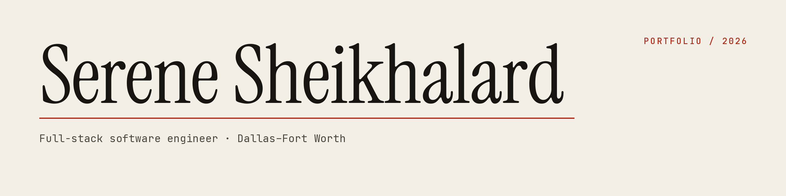

Full-stack software engineer in Dallas–Fort Worth. I build the interface and the API behind it — React and Next.js on the front, Laravel on the back.

**Open to:** entry-level software engineering roles · U.S. citizen · open to relocation

---

### Selected work

| Project | Stack | Live |
|---|---|---|
| **[Code Craft](https://github.com/serenesheikh23/CodeCraft)** — my own digital studio site with a full admin CMS. Lighthouse 98 Performance / 97 Accessibility / 100 Best Practices / 100 SEO on mobile. | Next.js 15, TypeScript, Prisma, Turso, NextAuth, Vercel Blob | [codecraftdigitalstudio.vercel.app](https://codecraftdigitalstudio.vercel.app) |
| **[Portfolio](https://github.com/serenesheikh23/serene-portfolio)** — personal site. Lighthouse 100/100/100/100 on mobile. | Next.js 15, TypeScript, Tailwind | [serene-sheikhalard-portfolio.vercel.app](https://serene-sheikhalard-portfolio.vercel.app) |
| **[Marketlly](https://github.com/serenesheikh23/marketlly)** — multi-role digital marketplace with VIP tiers, crypto payment verification, and an automated fulfillment bot. | Laravel 13, React 19, Node.js, MySQL, Redis, Docker | [marketlly.store](https://marketlly.store) |
| **Ismail Cosmetics** — bilingual Arabic/English RTL e-commerce, 110 API routes, 38-page SPA. Client work; repo private. | Laravel, React 19, Redux Toolkit, i18next | [ismailcosmetics.com](https://ismailcosmetics.com) |
| **drama.gov.sy** — live government institutional CMS, public site + dashboard (built at Mad Fox; repo private) | Laravel, Blade, Tailwind, RTL | [drama.gov.sy](https://drama.gov.sy) |

---

### What I work with

- **Front end:** React 19 · Next.js 15 · TypeScript · Redux Toolkit · Tailwind CSS · Vite · i18next
- **Back end:** Laravel 13 · PHP · Node.js · REST APIs · Sanctum · NextAuth · Prisma · MySQL · Turso · Redis · WebSockets
- **Ship & test:** Docker · Nginx · GitHub Actions · Vercel · PHPUnit · Vitest · code review

---

### Elsewhere

[Portfolio](https://serene-sheikhalard-portfolio.vercel.app) · [LinkedIn](https://www.linkedin.com/in/serene-sheikhalard) · [CV (PDF)](https://serene-sheikhalard-portfolio.vercel.app/Serene_Sheikhalard_Software_Engineer.pdf) · serenesheikh23@gmail.com
